<!-- contribution graph and stats card: real data, redrawn daily by .github/workflows/profile-art.yml (scripts/art.py)
     ascii portrait: typed out from an illustration of me (portrait-source.jpg) by scripts/portrait.py, run by hand when it changes -->

<h3><code>thotasuryatej@github ~ $ ./contributions.sh</code></h3>

 
 

<h3><code>thotasuryatej@github ~ $ whoami</code></h3>

<table>
<tr>
<td valign="top"></td>
<td valign="top"></td>
</tr>
</table>

 

<h3><code>thotasuryatej@github ~ $ ./links.sh</code></h3>

<b>Embedded Software Developer · IoT Engineer · Hyderabad, India</b>

---

### `$ cat about.md`

I build firmware for connected devices. At **PAT IoT Solutions** I write firmware for Wi-Fi smart switches and
lighting dimmers on ESP32, ESP8266 and Nuvoton MS51 microcontrollers, and I'm building a **Matter-based hub** that
brings those devices to Alexa, Google and Apple's smart-home ecosystems.

I like problems where hardware limits are real — tight memory, timing-critical events, devices that have to keep
working after the demo ends.

### `$ ls featured/`

| Project | What it is |
| --- | --- |
| [**Matter Smart-Home Hub**](https://github.com/thotasuryatej/IoT-Matter-Smart-Home-HUB) | Case study of ESP32-S3 bridge firmware that exposes a legacy switch/fan/curtain mesh as native Matter devices — connection pooling, memory placement across SRAM/PSRAM, and state sync across three control paths. |
| [**IoT Telemetry Device Agent**](https://github.com/thotasuryatej/iot-telemetry-device-agent) | C++17 firmware agent (simulated) that buffers sensor data on flash and uploads it reliably over a flaky link — ring buffer with crash-safe A/B checkpoints, at-least-once delivery with seq_id dedup, capped exponential backoff, priority-aware backpressure. |
| [**IoT Traffic Management in Wi-Fi Networks**](https://github.com/thotasuryatej/Traffic-Management-in-WiFi-Networks) | B.Tech major project: FQ-CoDel scheduling for IoT traffic in Wi-Fi networks, simulated in NS-3, including a MANET routing-protocol comparison (AODV, OLSR, DSDV, DSR). |
| [**ML Task Scheduling in Fog Computing**](https://github.com/thotasuryatej/vm-scheduling) | Comparing FCFS, Round Robin, SJF and PBKMS scheduling for fog-computing workloads, with the notebook, dataset and a results site. |

### `$ cat stack.md`

- **Firmware** — Embedded C / C++, RTOS-based task design (FreeRTOS, ESP-IDF), UART · I2C · SPI · GPIO
- **Smart home** — Matter, Wi-Fi switches, dimming (Phase-Cut, PWM, DALI, analog)
- **Microcontrollers** — ESP32, ESP32-S3, ESP8266, Nuvoton MS51
- **Also** — Python, NS-3 network simulation, OpenCV / YOLO computer vision

### `$ cat experience.md`

- **Embedded Software Developer**, PAT IoT Solutions — Sep 2025 – present
- **Firmware Engineer Intern**, CSR Electronologies — May 2025 – Sep 2025
- **B.Tech, Computer Science Engineering (IoT)**, Kakatiya Institute of Technology and Science — 2021 – 2025

### `$ cat recognition.md`

- Smart India Hackathon 2023 — national finalist, team leader (Smart Microgrid as a Service)
- Grand Contest 2024 — selected (LiDAR-enabled smartwatch for visually impaired users)

### `$ ./contact.sh`

[Portfolio](https://suryatejpatel.in) · [LinkedIn](https://www.linkedin.com/in/thota-suryatej/) · [thotasuryatej@gmail.com](mailto:thotasuryatej@gmail.com)
